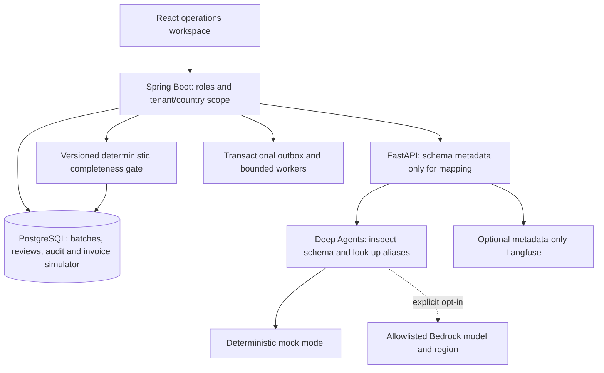

# AI insurance operations: synthetic rebuild

This extends the existing claims reference. It does not connect to official Turaco services, issue real invoices, send messages or move funds.

## Run and demonstrate

Use the root README's prerequisites and `python3 scripts/dev.py start`. The Java host runner copies the built archive into its managed runtime directory so rebuilding source cannot replace the running JVM's archive. Stop/restart to adopt a new build. Existing synthetic data and encryption keys are preserved.

Open the dashboard, sign in with the published local fixture, and select **Partner billing**. Paste a CSV from `fixtures/partner-billing/`, choose a partner code and month, then profile it. A reviewer explicitly accepts the column mapping. Java validates all rows and displays exceptions and normalized records. An approver must explicitly exclude exactly the invalid rows and approve the remaining records. A separate action prepares the simulated invoice. Repeating that action returns the same preparation; another batch cannot prepare a second invoice for the same scoped partner/month.

For claim quality, select **October completeness intake**. Record confirmation and assisted verification, then expand **Required documents**. The three synthetic requirements are admission record, discharge summary and identity document. Attach each as unverified text and record an authorized review with an evidence reference. Two verified documents, three uploads without verification, wrong associations, unreadable content and conflicting/stale facts do not establish completeness. September historical fixtures use their original rules; the new catalog takes effect for incidents from 1 October 2026. This effective date is a synthetic migration decision, not an official product term.

**Future-channel rehearsal** provides typed voice input, a scoped authoritative context summary and an approved notification simulation. Identity checks, consent, opt-out, local quiet hours and a per-claim throttle constrain previews. These are local rehearsals: no ASR, TTS, telecom or messaging service is enabled. The Swahili fixture and routing checks do not establish production translation or speech quality.

## Architecture



Billing state is durable in PostgreSQL, rather than in an agent's conversation. Mapping can resume after a dependency failure. Human review is mandatory even for a confident mapping. The agent never sees record values and cannot execute filesystem, shell, database, approval or payment tools. Its tool advertisement and execution are both allowlisted. An ephemeral state backend is created per request. Built-in Deep Agents tools are excluded from model access and rejected at execution.

CSV handling supports quoted fields and CRLF, bounded file/row/column sizes, unique headers, strict decimal premiums, required identifiers, country-specific currency and duplicate-policy detection. Hosted/demo uploads are intentionally small; the UI accepts up to 24 KB so the existing 32 KB gateway limit remains effective. Large-file object storage and streaming require a separate production design.

Only Spring Boot calculates totals. Raw partner uploads are encrypted with resource-bound AES-GCM. Normalized synthetic records, mappings and exception codes persist with the scoped batch. Reviews and invoice preparations are immutable under normal application privileges. Invoice uniqueness is enforced in PostgreSQL, including concurrent requests. Invalid rows can be explicitly excluded; they cannot be approved as valid.

Document reviews bind requirement version, claim, customer and current fact digest. Authorized waivers are separate from ordinary reviewer verification. Changed facts invalidate earlier decisions. The existing evidence discrepancy and payout safeguards still apply even after completeness succeeds. Document verification uses a synthetic text comparison; it is not OCR, identity enrollment or medical validation.

## API

All operations require existing scoped staff JWTs. Existing role names are reused for this synthetic slice.

| Route | Permission | Result |
|---|---|---|
| `GET /api/v1/billing/batches` and `/{id}` | claims:read | Batch metadata, validation, timeline and simulated preparations |
| `POST /api/v1/billing/batches` | claims:write | Encrypted CSV intake; requires Idempotency-Key |
| `POST /api/v1/billing/batches/{id}/mapping-reviews` | claims:review | Explicit mapping acceptance and deterministic validation |
| `POST /api/v1/billing/batches/{id}/approvals` | claims:approve | Audited approval and explicit invalid-row exclusion |
| `POST /api/v1/billing/batches/{id}/invoice-preparations` | claims:approve | Idempotent local simulated preparation |
| `POST /api/v1/billing/batches/{id}/resumptions` | claims:write | Retry failed mapping without a new batch |
| `POST /api/v1/billing/batches/{id}/cancellations` | claims:approve | Cancel an unapproved batch |
| `GET /api/v1/billing/batches/metrics` | claims:review | Observed stage counts and receipt-to-invoice timing |
| `GET /api/v1/claims/{id}/completeness` | claims:read | Versioned requirements and current evidence status |
| `POST /api/v1/claims/{id}/document-reviews` | claims:review | Verify or flag current associated evidence |
| `POST /api/v1/claims/{id}/document-waivers` | claims:approve | Explicit audited requirement waiver |
| `GET /api/v1/claims/{id}/ai-traces` | claims:read | Metadata from trusted service extraction calls |
| `GET /api/v1/claims/{id}/channel-summary` | claims:read | Verified-identity scoped context |
| `POST /api/v1/voice/simulations` | claims:write | Typed-transcript response and human handoff |
| `POST /api/v1/notifications/simulations` | claims:approve | Consent/quiet-hours/throttle-aware local preview |

Typed evidence uses the existing evidence endpoint with `document_type`, `customer_id` and optional `extraction_confidence`. The server verifies customer ownership. Confidence never establishes verification. Generated contracts in `docs/openapi/` describe request bodies.

## Model configuration

The user delegated provider choices. [ADR-003](decisions/ADR-003-selected-deployment.md) selects the first Bedrock candidate and region, records safe configuration/IAM examples, and separates current demo hosting from the managed pilot target.

Default: `AI_PROVIDER=mock`, `MAPPING_PROVIDER=mock`. No credentials are needed. Deep Agents is pinned to 0.7.28 with its AWS extra in the frozen Python lockfile. Existing OpenAI and Anthropic extraction adapters remain available behind their existing gates.

Bedrock mapping requires `MAPPING_PROVIDER=bedrock` and `BEDROCK_ENABLED=true`. Bedrock claim extraction additionally requires `AI_PROVIDER=bedrock` and `REAL_PROVIDER_ENABLED=true`.

Configure `BEDROCK_REGION`, `BEDROCK_MODEL_ID`, comma-separated `BEDROCK_ALLOWED_REGIONS` and `BEDROCK_ALLOWED_MODEL_IDS`. Supply approved current token prices through `BEDROCK_INPUT_USD_PER_MILLION` and `BEDROCK_OUTPUT_USD_PER_MILLION`, and a positive `BEDROCK_MAX_REQUEST_USD` no greater than 1. The adapter rejects missing access policy or a conservative token-cost ceiling above that budget. Mapping permits at most three model calls, 700 output tokens per call and a 25-second graph deadline. Claim extraction permits one call and 1,500 output tokens. SDK retries are disabled for Bedrock. Two concurrent mapping requests are allowed per process. These are process-local safeguards, not an account-level billing limit.

Use the normal AWS SDK credential chain or an approved workload role. Credentials are not embedded in source or inferred from public documentation. The Compose configuration does not mount a developer AWS credentials directory. Provide workload identity explicitly for an approved live environment. No specific model/region access is claimed.

Opt-in schema-only smoke, from an environment with the approved configuration:

```sh
BEDROCK_LIVE_SMOKE=true services/ai-service/.venv/bin/python scripts/bedrock-smoke.py
```

The smoke is never part of default CI. A mocked SDK contract is not a live model evaluation.

## Provenance, observability and evaluation

Mapping results record model, provider, prompt version, trace ID, correlation ID, tools, evaluation status and latency. Mock cost is zero; live cost is not invented. The original extraction service now attaches server-generated model metadata, and trusted text-intake calls retain it in append-only scoped trace rows. Client-supplied extraction metadata is not financial authority. Optional Langfuse task exports use a fixed metadata allowlist; they exclude transcript text, columns, records and customer identifiers.

Billing timing is measured from receipt through recorded stages. Metrics do not claim a reduction against Turaco's interview baseline. Every mapping and approval in this slice is reviewed, so straight-through processing is not claimed. Mapping accuracy and completeness precision/recall refer only to the checked synthetic fixtures until representative datasets exist.

```sh
# Service directory:
cd services/ai-service
uv sync --frozen
uv run --frozen pytest -q
uv run --frozen python -m app.evaluation ../../datasets/eval/hospital-cash.json --check
# Repository root, with the synthetic stack running:
API_URL=http://127.0.0.1:18080 python3 tests/e2e/full_platform.py
API_URL=http://127.0.0.1:18080 python3 scripts/rebuild-check.py
```

The rebuild harness exercises three billing fixtures and twelve completeness scenarios through authenticated HTTP APIs. It writes measured results privately to `.cache/verification/rebuild-check.json`. Golden cases cover 0/3 through 3/3, upload versus verification, duplicates, unreadability, conflicting dates, Swahili, wrong customer/claim and stale facts. CI runs the same acceptance workflow after Compose and kind deployment. A configured CI check is not evidence of a completed remote run.

## Migration and rollback

Flyway applies V5–V9 additively: billing and completeness, channel simulations, invoice-total capacity, AI provenance, and wall-clock billing stage timestamps. Existing claims, obligations and attempts are retained. Initial local seeding creates the effective-dated synthetic requirement catalog. Existing installations receive requirements for their existing Hospital Cash products during V5.

Back up the synthetic database and preserve its encryption key before adopting the rebuild. Do not edit applied migrations. Roll back an application build only after verifying compatibility with the expanded schema; never drop history to make an older binary start. The historical release 0.2.0 at `24935a7` remains a distinct artifact and has not been replaced or relabeled by this worktree.

## External completion gates

Real identity/payee enrollment, official requirements and billing rules, representative multilingual/media evaluation, production privacy/retention/operations approval, account-level cost controls, authorized provider contracts and chosen hosting remain necessary. The user must supply AWS account/region/model access and integration destinations. Live messaging, invoices, adjudication and money transfers are not enabled by implementing simulator endpoints.

## Current documentation references

The old sample-use-case links ending `getincidenttypes-1`, `getpolicybenefits-1` and `reference/api` return 404. Current references are [incident types](https://docs.turaco.insure/reference/getincidenttypes), [benefits](https://docs.turaco.insure/reference/getpolicybenefits), and [API overview](https://docs.turaco.insure/reference/api-1). The [required-document endpoint](https://docs.turaco.insure/reference/getclaimdocuments) documents categories and uploaded status. The [upload endpoint](https://docs.turaco.insure/reference/uploadclaimdocument) documents document verification fields. Public schemas still require authorized contract validation, including inconsistencies between webhook overview and schema authentication options.
