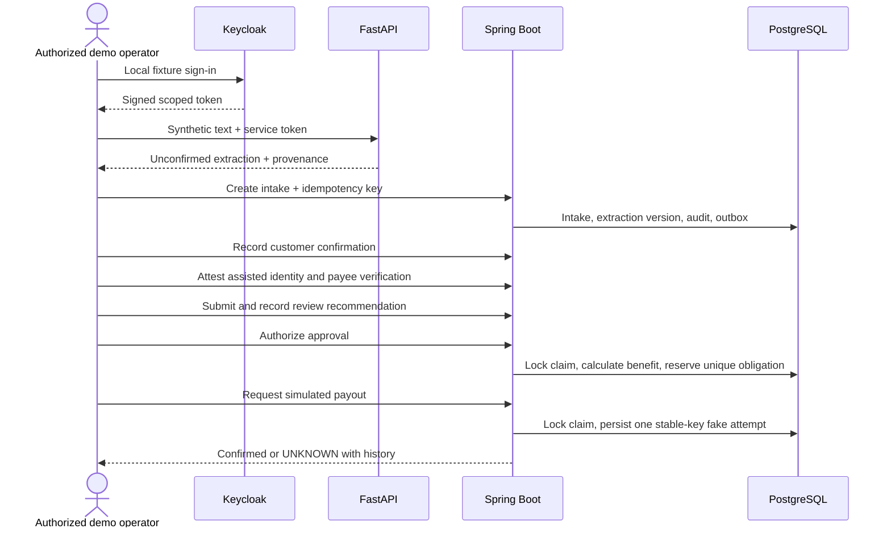

# Sprint 1 architecture

The current 0.2 architecture extends this baseline as described in [ADR-002](decisions/ADR-002-local-platform.md). Outbox workers, provider synchronization, durable conversations, evidence checks and recovery are now implemented locally. Statements below about deferred modules describe the original Sprint 1 boundary.

Java owns authoritative standalone claims, verification attestations, policy checks, human decisions and the simulated ledger. FastAPI extracts candidate values. Keycloak issues asymmetric JWTs; issuer, audience, expiry, roles and tenant/country claims constrain access. The dashboard and demo use the same protected API.

Separate snapshots track intake, provider-claim and payout states. Every transition records actor, time, source, policy version and correlation ID. Confirmation adds an extraction version. Model output cannot self-confirm. Incomplete information can create an intake, while submission requires confirmed critical fields and staff-attested identity.

Four ports cover policies, customers, the product catalog and claim submission. `StandaloneAdapter` uses scoped local tables. Submission records local RECEIVED state; it does not pretend to call Turaco. Uploads and external DTOs await verified contracts. A startup guard prevents standalone behavior being used under integration configuration.

Business rows carry tenant/country scope, composite foreign keys prevent cross-scope relationships, and signed token claims determine request scope. Explicit JDBC queries include both columns. Tenant is an administrative root; country configuration defines residency/retention metadata. Public tenant onboarding is not exposed.

Approval and fake payout run in transactions with a claim-row lock. A database constraint enforces one obligation per tenant/claim/benefit/version. A stable provider reference is persisted with each obligation/attempt. Repeated approved calls return the same obligation; confirmed payments return the original result. UNKNOWN blocks further attempts pending future reconciliation tooling. No network payment client exists.

Audit and outbox records commit with each business action. The outbox is a durable backlog only: SQS relay, workers, notifications and dead letters are not implemented in this synchronous sprint.

The local profile plus LOCAL_SEED enables synthetic seeds. Dedicated local Keycloak fixtures contain demo users. Real identity enrollment, least-privilege database roles, encryption/retention enforcement and country/vendor review remain release gates.
