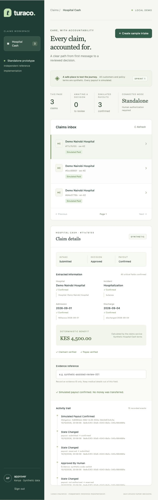

# Sprint 1 verification · 15 October 2026

Historical baseline. Superseded for the current build by [SDLC status](SDLC-status.md).

The standalone synthetic vertical slice is implemented and exercised. The complete container gate remains open because this machine's Docker engine cannot create containers. This is a working local prototype, not a production release or a claim that every Sprint 1 deployment gate has passed.

| Check | Actual result |
|---|---|
| Java 25 / Spring Boot 4.1.1 package and verify | Passed |
| Java automated tests | 11 passed, no failures/skips |
| PostgreSQL migrations and concurrency | Passed on installed PostgreSQL 17.11, disposable database, no H2 |
| Duplicate claim creation / changed payload conflict | Passed, including six concurrent creates |
| Approval and fake payment races | Passed, eight concurrent calls each, one obligation/attempt |
| Unconfirmed/missing fields and unknown incident code | Blocked as expected |
| Reviewer without approval role | Denied in API test and real-Keycloak demo |
| Tenant/country isolation and missing scope | Passed |
| Immutable audit and database uniqueness | Passed |
| UNKNOWN payment retry | Blocked as expected |
| JWT signature/issuer/audience/expiry | Positive and negative tests passed |
| Python regression suite | 9 passed; one upstream Starlette/httpx deprecation warning |
| Real OpenAI SDK adapter | Mocked SDK contract passed; no live request or credentials used |
| Python vulnerability audit | No known vulnerabilities found at verification time |
| React production build | Passed |
| npm dependency audit | Zero vulnerabilities after updating Vite to 7.3.7 |
| Compose configuration | Validated |
| Full synthetic authenticated demo | Passed with official Keycloak 26.4.0 running locally, Java, Python and PostgreSQL |
| Complete English, Swahili and code-switched fixtures | Three claims, each simulated KES 4,500, 15 audit events, safe replays |
| Browser verification | Real sign-in, persisted claims, confirmed evidence, benefit and audit trail visible |
| Docker builds / Testcontainers path | Configured, not passed locally; Docker storage returned read-only errors and then engine requests hung |
| CI / Java dependency scanner | Configured, not executed on GitHub; nothing pushed |

The final Java run includes a shared policy lock during eligibility checks, current policy-version audit references and a correlation filter ordered before authentication. Source files were formatted and recompiled. The demo ran against the final packaged service. Real Keycloak testing caught a missing subject mapper; the local realm fixture now includes the standard basic client scope, and the corrected fixture behavior was verified with real tokens.

The session's live preview uses `http://localhost:5173`, API `http://127.0.0.1:18080`, extraction `http://127.0.0.1:8000`, Keycloak `http://localhost:8081`, and a disposable host PostgreSQL cluster on 55432. The alternate API port avoids a pre-existing Docker listener. Runtime dependencies and databases are temporary local artifacts, not committed deployment dependencies.

## Remaining gates

Run the checked-in Testcontainers/Compose CI on a healthy Docker engine, including fresh image builds and Java dependency scanning. The host PostgreSQL tests verify real constraints and transactions, but do not establish container-image compatibility. Verify fresh-clone setup there before declaring the entire Sprint 1 infrastructure gate complete.

Before any real deployment: real identity/payee verification, official policy terms, vendor/privacy approval, real multilingual evaluations, encrypted storage/TLS, least-privilege credentials, retention/consent handling, external provider contracts and reconciliation. None are represented as completed by the synthetic demo.

